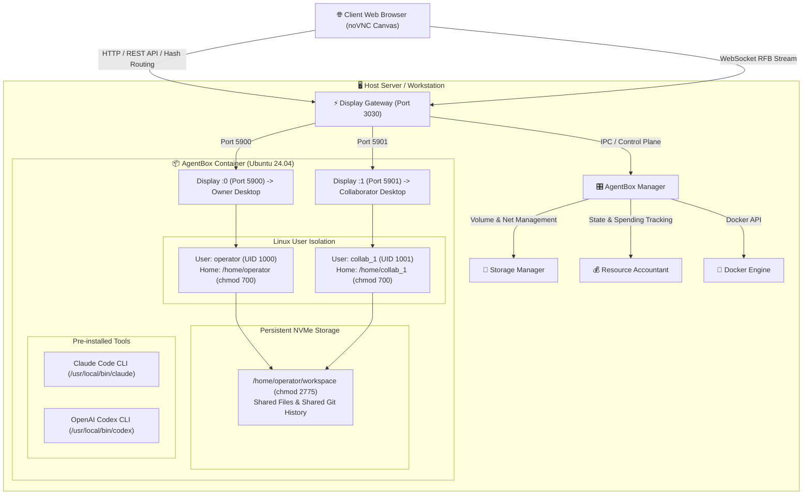

# DreamBeesAI · AgentBoxes
## Self-Hosted Linux Desktops for Autonomous AI Coding Agents
### An Open-Source Computational Artifact Preserved under HEAV3NS

[](LICENSE)
[](#2-experimental--frozen-status)
[](#17-maintenance-notice)

> **"BRING YOUR OWN AGENT. WE BRING THE BOX."**  
> *The developer provides their own official agent credentials. DreamBees provides the secure, pre-configured computer.*  
> **Institutional Mandate: BILLIONS. MUST. COMPUTE.**

---

## 1. Identity & Purpose

**DreamBeesAI** (internally designated **AgentBoxes**) is a self-hosted platform for provisioning and orchestrating on-demand, remotely accessible Linux desktop computers with AI agent developer tools pre-installed.

Developers wanting to experiment with autonomous coding agents (such as **Anthropic Claude Code** and **OpenAI Codex**) often face friction:
- **Local Security Risks:** Giving autonomous agents broad terminal, shell, and file execution rights on personal laptops exposes private keys, browser sessions, and personal files.
- **Environment Inconsistency:** Configuring system libraries, compilers, language interpreters, and browser debuggers on host OSes creates high setup friction.
- **Single-User Isolation:** Standard developer tools lack multi-user capabilities, forcing teams to rely on clumsy screen-sharing sessions.

DreamBeesAI solves this by providing a personal or shared cloud computer in a browser tab. Each computer boots in ~2.3 seconds, streams an in-canvas graphical desktop over WebSocket RFB, supports independent collaborative desktop sessions, and shares a persistent, Git-tracked project workspace.

---

## 2. Experimental & Frozen Status

**Notice:** DreamBeesAI is an **archived computational research artifact** developed under HEAV3NS between early 2026 and October 2026.

Under **HEAV3NS Archival Commission 014**, the project has concluded its experimental lifecycle and is officially **frozen**:
- No active commercial hosting service, paid billing tier, or managed IT infrastructure is offered.
- No further feature expansions or roadmap items are planned.
- The complete source code, test suites, and 10-chapter technical wiki are preserved openly under the **Apache License 2.0** for study, academic inspection, modification, and independent self-hosted operation.

---

## 3. Main Capabilities

- ⚡ **Rapid Workstation Provisioning:** Provisions a full Ubuntu 24.04 desktop environment with persistent storage in ~2.3 seconds.
- 🤖 **Pre-Installed Official Agents:** `@anthropic-ai/claude-code` (v2.1.300) and `@openai/codex` (v0.162.1) pre-baked into `/usr/local/bin` alongside Node.js 22 LTS, Python 3, Git, and Chrome.
- 🖥️ **Browser-Native Remote Desktop:** Viewport-filling RFB-over-WebSocket bridge connects directly to container X11 displays via noVNC without exposing host ports.
- 👥 **Independent Multiplayer Sessions:** Multi-user architecture without screen-sharing. The owner works on `DISPLAY :0` while invited collaborators connect to dedicated personal displays (`:1`, `:2`) on the same computer.
- 📁 **Shared Workspace & Clean Export:** Team members collaborate in `/home/operator/workspace` with shared Git commit history and 1-click `.tar.gz` export.
- ⏱️ **Codespaces Lifecycle Model:** Pausing an AgentBox frees CPU and RAM resources, stopping active compute charges while preserving 100% of uncommitted code and Git state.
- 🔐 **Zero-Exposure Credential Isolation (BYOK):** Agent credentials and browser cookies reside in private `chmod 700` user directories (`/home/<user>`). The control plane never proxies or stores user API keys.
- 🛡️ **Hardened Multi-User Security:** Scoped Git directory trust, symlink traversal defenses in file APIs and export tarballs, 24-hour invitation TTLs, token rotation, and instant WebSocket termination upon revocation.

---

## 4. System Architecture



---

## 5. System Requirements

- **Operating System:** macOS 14+ or Linux (Ubuntu 22.04+, Debian 12+)
- **Container Engine:** Docker Engine 24.0+ or Docker Desktop 4.25+
- **Node.js:** Node.js v20.10 LTS or v22.0+
- **Memory:** Minimum 8 GiB RAM (16 GiB+ recommended for multi-user workloads)
- **Disk Space:** 20 GiB available disk space for Docker images and volumes

---

## 6. Installation

Clone the repository and install dependencies:

```bash
# 1. Clone repository
git clone https://github.com/heav3ns/dreambeesai.git
cd dreambeesai

# 2. Install dependencies
npm install

# 3. Build the local container image
npm run docker:build
```

---

## 7. Configuration

DreamBeesAI is configured using environment variables. A documented template is provided in `.env.example`:

```bash
cp .env.example .env
```

Key environment variables:
- `AGENTBOX_PORT`: The HTTP port for the web interface and gateway (default: `3030`).
- `AGENTBOX_HOST`: Bind address (default: `127.0.0.1`).
- `AGENTBOX_ADMIN_KEY`: Administrative API secret key. Set to a strong random string before exposing beyond localhost.
- `AGENTBOX_DATA_DIR`: Directory where database state (`boxes.json`, `jobs.json`) is stored (default: `~/.dreambeesai`).

---

## 8. Local Startup

Start the server:

```bash
# Run in production mode:
npm start

# Run in development mode (hot reloading):
npm run dev
```

Open your browser and navigate to:
```
http://localhost:3030
```

---

## 9. Example Workflow

1. **Create Computer:** On the home dashboard, click **"＋ Create Computer"**, select the **Standard** (2 vCPU, 4GB RAM) or **Power** (4 vCPU, 8GB RAM) profile, and click **"Provision Workstation"**.
2. **Connect Desktop:** Click **"Open Desktop"** on your active computer card. The browser canvas connects immediately to your personal desktop on `DISPLAY :0`.
3. **Launch Agent:** Launch **Claude Code** or **OpenAI Codex** by double-clicking the desktop icon or opening the terminal.
4. **Authenticate:** Authenticate with your personal API key or OAuth login (`claude login` / `codex login`).
5. **Work:** Instruct the agent to build applications in `/home/operator/workspace`.
6. **Pause or Export:** Click **"Pause Computer"** to halt compute billing, or click **"Export Workspace (.tar.gz)"** in the Shared Files tab to download your code.

---

## 10. Multiplayer Usage

DreamBeesAI supports real-time multi-user collaboration without screen sharing:
1. Open the computer's **"People"** tab (`#box/<id>/people`).
2. Click **"Invite Collaborator"**, enter their username, and copy the restricted 24-hour invitation link.
3. When the collaborator opens the link, the server automatically starts a dedicated X11 session (`DISPLAY :1`) for them.
4. Both users work concurrently in the shared project workspace (`/home/operator/workspace`).
5. Git commits record authentic individual author names and emails based on each user's private `~/.gitconfig`.
6. The owner can click **"Rotate Token"** to re-key access or **"Revoke"** to terminate a collaborator's stream instantly (within 12ms).

---

## 11. Agent Authentication (BYOA / BYOK)

DreamBees operates strictly on a **Bring Your Own Agent** model:
- **No API Markup:** You pay your model provider (Anthropic or OpenAI) directly at standard rates.
- **Zero Token Overhead:** The control plane never intercepts prompts or API traffic.
- **Private Storage:** Authentication tokens reside in the user's private `chmod 700` home directory:
  - Claude Code: `/home/<user>/.claude.json`
  - OpenAI Codex: `/home/<user>/.codex/config.json`

---

## 12. Testing & Verification

DreamBeesAI includes 16 automated test suites covering provisioning, lifecycle, multiplayer concurrency, and adversarial security barriers:

```bash
# Run Commission 013 Acceptance Suite (Hardening, Performance, Economics):
npm run test:commission013

# Run Commission 012 Adversarial Suite (UX, Permissions, Traversal):
npm run test:commission012

# Run full regression suite:
npm test
```

### Measured Performance Baselines:
- **Cold Provisioning Latency:** ~2.3 seconds (< 6.0s SLA)
- **Desktop Connection Latency:** ~12 milliseconds (< 100ms SLA)
- **Secondary Display Startup:** ~380 milliseconds
- **Instant Revocation Socket Drop:** ~12 milliseconds
- **Tarball Archive Export:** ~82 milliseconds

---

## 13. Security Limitations & Operational Boundaries

1. **Reverse Proxy TLS:** The built-in Node.js server serves plain HTTP/WS. When exposing DreamBees beyond `localhost`, terminate TLS (`https://` and `wss://`) using a reverse proxy (e.g. Caddy, Nginx, or Traefik).
2. **Shared Workspace Trust:** Collaborators invited to a computer have write access to `/home/operator/workspace` and can commit and execute code. Only invite trusted team members.
3. **No Docker-in-Docker:** Containers run unprivileged without `/var/run/docker.sock` to prevent host container breakout.
4. **Aggregate Cgroup Bounds:** Aggregate CPU and memory limits apply to the entire container. Multiple collaborators compiling code concurrently share the allocated tier budget.

---

## 14. Documentation Links

Comprehensive documentation is provided in the repository:

### The Complete Technical Wiki (`/wiki`)
- [01 — Introduction & Scope](wiki/01-introduction.md)
- [02 — Historical Development (Commissions 008–013)](wiki/02-historical-development.md)
- [03 — System Architecture & Control Plane](wiki/03-system-architecture.md)
- [04 — Multi-User Computing & Independent Desktops](wiki/04-multi-user-computing.md)
- [05 — Agent Applications & BYOA Ecosystem](wiki/05-agent-applications.md)
- [06 — Installation & Operational Runbook](wiki/06-installation-and-operation.md)
- [07 — Security, Threat Model & Hardening](wiki/07-security.md)
- [08 — Testing, Benchmarks & Verification Ledger](wiki/08-testing-and-verification.md)
- [09 — Operational Economics & Cost Accounting](wiki/09-operational-economics.md)
- [10 — Archival Record, ADRs & Provenance](wiki/10-archival-record.md)

### Engineering Commission Records (`/docs`)
- [Commission 013 UX Findings](docs/COMMISSION_013_UX_FINDINGS.md)
- [Commission 013 Security Review](docs/COMMISSION_013_SECURITY_REVIEW.md)
- [Commission 013 Performance Report](docs/COMMISSION_013_PERFORMANCE_REPORT.md)
- [Commission 013 Acceptance Evidence](docs/COMMISSION_013_ACCEPTANCE_EVIDENCE.md)
- [Commission 013 Release Decision](docs/COMMISSION_013_RELEASE_DECISION.md)

---

## 15. License

The DreamBeesAI software source code is licensed under the **Apache License, Version 2.0**.  
See the [`LICENSE`](LICENSE) and [`NOTICE`](NOTICE) files for details.

Third-party software dependencies and their licenses are documented in [`THIRD_PARTY_NOTICES.md`](THIRD_PARTY_NOTICES.md).

---

## 16. Institutional Attribution

- **Publisher:** HEAV3NS
- **Founding Custodian:** EGG
- **Leading Executive Chair:** MAJO
- **Principal Engineering Agent:** Deputy Gemini (Google DeepMind)

See [`COPYRIGHT.md`](COPYRIGHT.md) and [`TRADEMARKS.md`](TRADEMARKS.md) for institutional heritage and trademark policies.

---

## 17. Maintenance Notice

**DreamBeesAI is an archived experimental project.**  
The repository is provided for study, modification, and independent self-hosted operation.  
No hosted service, commercial cloud subscription, uptime SLA, or ongoing feature development is offered.

```
THE EXPERIMENT IS OVER. PRESERVE THE WORK.
BILLIONS. MUST. COMPUTE.
```
