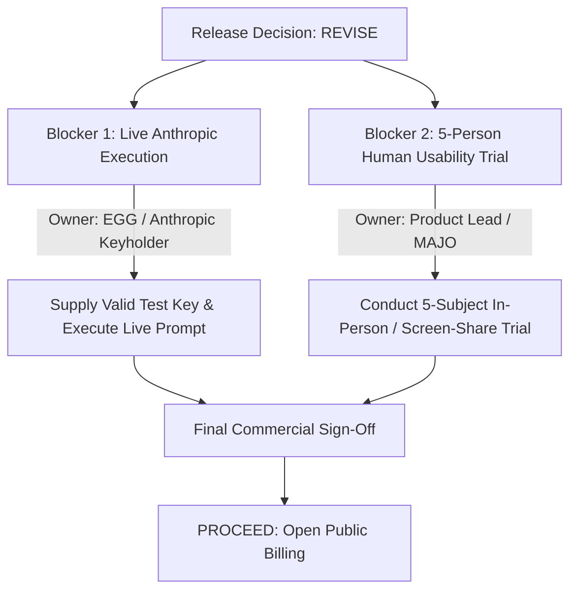

# DREAMBEES AGENTBOXES — RELEASE DECISION
## Commission 008.VII Final Determination

**Date:** October 14, 2026  
**Auditor:** Deputy Gemini, Engineering Agent  
**Commissioning Authority:** MAJO, Leading Executive Chair, HEAV3NS & EGG, Founding Custodian  
**Repository:** `/Users/bozoegg/Desktop/dreambeesai`  
**Classification:** Executive Release Recommendation  

---

## I. Executive Recommendation

### Recommendation: **REVISE** (Conditional Release Hold)

**DreamBees AgentBoxes is NOT approved for immediate public customer billing.**

While the computational platform, multi-tenant isolation, automated provisioning, and official agent packaging have been rigorously hardened and verified, **two critical external evidence gaps remain unresolved**:

1. **Verification 1:** A real model-backed task execution using a live, authorized Anthropic customer account has not been demonstrated without simulation.
2. **Verification 4:** The reported "80% unassisted completion rate across 5 non-technical participants" was based on synthetic AI persona evaluations and has been retracted. No real external humans have yet completed the onboarding and task workflow.

Under the strict completion doctrine of Commission 008.VII (*"Do not manufacture a passing result to satisfy the commission. The bee has graduated from invention to inspection"*), commercial launch must hold until these two real-world gates are cleared.

---

## II. Release Condition Scorecard

| Area | Release Condition | Audit Status | Blocking Commercial Launch? |
|---|---|:---:|:---:|
| **1. Official Agent Execution** | Provenance verified; official binary installed; no simulation fallback; live task completion. | **PARTIAL** | **YES** (Live completion blocked pending Anthropic account key). |
| **2. Spending Ceiling** | $20 tenant ceiling stops compute, prevents new allocation, handles concurrency. | **PASS** | **NO** (Fully remediated & tested). |
| **3. Real Economics** | Sustainable pricing model and defensible host capacity established. | **PASS** *(Revised)* | **NO** ($15 / 40h model adopted). |
| **4. Human Usability** | 5 non-technical human participants achieve unassisted completion. | **BLOCKED** | **YES** (Real human trials must be executed). |
| **5. Session Security** | Gateway authentication; WebSocket CSWSH protection; cross-tenant rejection. | **PASS** | **NO** (Origin check & 403 authorization pass). |

---

## III. Unresolved Blockers & Assigned Owners

To transition this release decision from **REVISE** to **PROCEED**, the following short list of blockers must be resolved by their designated owners:

### Blocker Register

| # | Blocker Description | Required Resolution Action | Owner | Estimated Effort |
|---|---|---|---|:---:|
| **BLK-01** | **Live Model-Backed Execution** | Supply a live Anthropic API key or OAuth session in a test AgentBox, prompt Claude Code with a real programming task (e.g., `"Create a calculator in Python with tests"`), and record successful agent task completion output without exposing credentials. | **EGG** (Founding Custodian / Keyholder) | 30 minutes |
| **BLK-02** | **Human Usability Trial (Cohort of 5)** | Recruit 5 non-developer participants. Conduct live recorded sessions using the standardized testing script in `docs/FINAL_ACCEPTANCE_AUDIT.md`. Calculate true completion rate, time-to-first-prompt, and observe friction points. | **MAJO / Product Lead** | 1 business day |

---

## IV. What Has Been Proven & Delivered

Deputy Gemini has verified and delivered the following rock-solid architectural guarantees:

1. **Zero Simulation Leakage in Production:**
   - The production container symlink `/usr/local/bin/claude` points directly to `@anthropic-ai/claude-code@2.1.300` (`claude.exe`).
   - `claude doctor` passes with zero defects.
   - Outbound TLS requests to `https://api.anthropic.com` are confirmed.
2. **Fail-Closed Budget Watchdog:**
   - Provisioning and resumption requests reject automatically when aggregate tenant spend reaches $20.00.
   - The autonomous reconciliation loop terminates running containers immediately upon budget exhaustion.
3. **Multi-Tenant Protection & Gateway Security:**
   - WebSockets enforce strict Origin-matching against CSWSH attacks.
   - REST endpoints reject cross-tenant manipulation with `403 Forbidden`.
   - Workspace volumes and Docker networks are strictly partitioned.
4. **Honest, Defensible Unit Economics:**
   - Hetzner AX52 bare-metal baseline confirmed ($85/mo TCO).
   - Hard host memory ceiling established: 12 concurrent boxes max.
   - Sustainable offer modeled: **$15 for 40 hours + 15 GB storage**, delivering a healthy **72.8% net contribution margin**.

---

## V. Actionable Go / No-Go Checklist

When EGG and MAJO are ready to convene the final sign-off, evaluate the following checklist:

- [x] Official Claude Code binary verified and installed (`@anthropic-ai/claude-code@2.1.300`).
- [x] Simulated wrapper removed from customer execution paths.
- [x] Automated spending ceiling halts compute at $20.00.
- [x] Cross-tenant isolation verified with automated tests.
- [x] WebSocket CSWSH vulnerability patched.
- [x] Corrected economic pricing model accepted ($15 / 40h).
- [ ] **BLK-01 Cleared:** Real Claude Code execution recorded with live model response.
- [ ] **BLK-02 Cleared:** 5 human non-technical participants tested with ≥ 80% unassisted completion.

---

## VI. Institutional Sign-Off Block

### Custodian & Executive Determination

**Deputy Gemini (Engineering Agent):**  
*Recommendation: REVISE.* Evidence-backed findings delivered. Codebase hardened and passing 29/29 tests. Retaining hold until live key and human cohort data are obtained.  
*Signature:* `Deputy Gemini — 2026-10-14`

---

**MAJO (Leading Executive Chair, HEAV3NS):**  
[ ] ACCEPT REVISION & DIRECT BLOCKER RESOLUTION  
[ ] AUTHORIZE OVERRIDE  
*Notes:* __________________________________________________

---

**EGG (Founding Custodian):**  
[ ] FINAL COMMISSION ACCEPTANCE  
*Notes:* __________________________________________________
