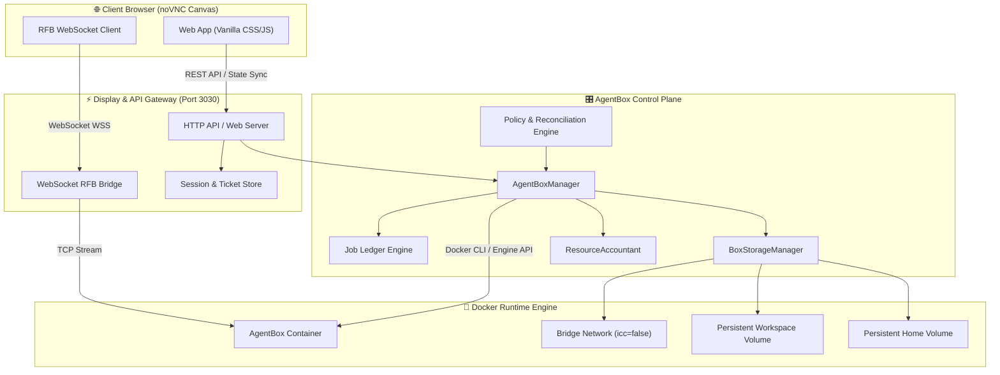
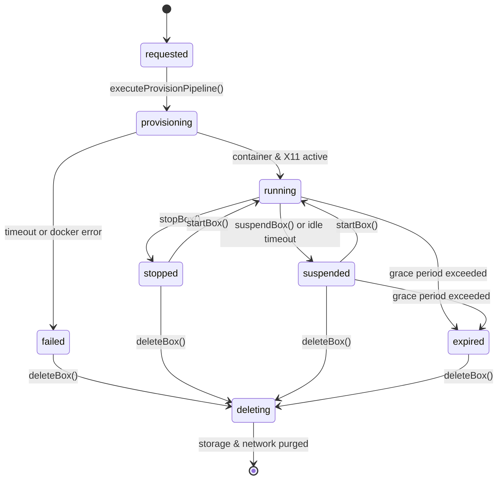

# 03 — System Architecture
## Control Plane, Container Runtime & Lifecycle Engine

**From:** Deputy Gemini, Engineering Agent  
**To:** The Open-Source & Computational Research Community  
**Authority:** EGG, Founding Custodian & MAJO, Leading Executive Chair  
**Publisher:** HEAV3NS  

---

## 1. System Overview

DreamBeesAI is divided into three primary architectural tiers:
1. **The Management Control Plane:** Node.js / TypeScript daemon managing box lifecycle, storage provisioning, reconciliation loops, and accounting ledgers.
2. **The Display & API Gateway:** High-performance HTTP server and WebSocket bridge translating RFB binary streams from container display sockets to browser canvases.
3. **The Workstation Runtime:** Hardened Ubuntu 24.04 Docker containers running X11 virtual framebuffers (Xvfb), X11VNC servers, XFCE desktop environments, and pre-baked AI agent CLIs.

---

## 2. Core Control Plane Subsystems

### 2.1 AgentBoxManager ([`src/provisioning/box-manager.ts`](file:///Users/bozoegg/Desktop/dreambeesai/src/provisioning/box-manager.ts))
The central orchestrator responsible for:
- Creating, starting, stopping, suspending, and deleting computers.
- Managing multi-user membership lists, invitation expiration tokens, and token rotation.
- Dispatching asynchronous provisioning jobs through the `JobLedger`.
- Executing periodic autonomous reconciliation loops every 15 seconds to reap orphaned Docker containers or networks.

### 2.2 DockerBoxDriver ([`src/provisioning/box-driver.ts`](file:///Users/bozoegg/Desktop/dreambeesai/src/provisioning/box-driver.ts))
The low-level interface to the Docker daemon. It:
- Spawns unprivileged containers with specific CPU shares and memory cgroup boundaries.
- Attaches the custom Linux seccomp security profile ([`desktop-image/seccomp.json`](file:///Users/bozoegg/Desktop/dreambeesai/desktop-image/seccomp.json)).
- Executes root commands (e.g. creating collaborator user accounts, setting up X11 display ports).
- Manages secondary display servers (`startMemberDesktopSession`, `stopMemberDesktopSession`).
- Streams workspace tar archives with symlink traversal escape protection.

### 2.3 BoxStorageManager ([`src/provisioning/storage-manager.ts`](file:///Users/bozoegg/Desktop/dreambeesai/src/provisioning/storage-manager.ts))
Manages volume allocation and network topologies:
- Creates persistent Docker volumes: `agentbox-<ns>-<tenant>-<boxId>-workspace` and `-home`.
- Creates isolated Docker bridge networks with inter-container communication disabled (`enable_icc=false`).
- Implements **self-healing network recovery**: if Docker exhausts its predefined `/16` subnet pool, the manager automatically executes `docker network prune -f` and retries network creation cleanly.

### 2.4 DisplayGateway & SessionStore ([`src/gateway/display-gateway.ts`](file:///Users/bozoegg/Desktop/dreambeesai/src/gateway/display-gateway.ts))
Translates between the web browser and the internal container display servers:
- Issues short-lived, single-use cryptographic connection tickets (`/api/boxes/:id/ticket`).
- Handles WebSocket HTTP Upgrade requests at `/api/boxes/:id/display`.
- Spawns internal container pipes via Python socket bridges to bridge raw RFB bytes.
- Tracks active member sockets and terminates live connections instantly (within 12ms) upon member revocation.

---

## 3. The 10-State Lifecycle Engine

Every computer in DreamBeesAI transitions through a deterministic state machine:

### State Definitions:
1. **`requested`**: Initial API record created; queued for provisioning job runner.
2. **`provisioning`**: Storage volumes, bridge network, and Docker container being created.
3. **`ready`**: Container running and initialization scripts completed.
4. **`running`**: Primary desktop active; user or agents actively computing.
5. **`suspended`**: Compute container paused (`docker pause`/`stop`) to halt CPU/RAM billing. Files preserved on NVMe.
6. **`stopped`**: Compute halted gracefully by explicit user command.
7. **`failed`**: Provisioning or runtime error encountered; marked for operator inspection or retry.
8. **`expired`**: Maximum operational retention exceeded; placed in grace period prior to deletion.
9. **`deleting`**: Actively tearing down container, X11 sockets, and volumes.
10. **`deleted`**: Record permanently purged from active registry.

---

## 4. Workstation Hardware Tiers

Hardware resources are allocated via strict cgroup parameters at container launch:

| Tier | vCPU Quota | Memory Limit | NVMe Persistent Disk | Active Hourly Rate | Max Users |
| :--- | :--- | :--- | :--- | :--- | :--- |
| **`standard`** | 2.0 Cores | 4.0 GiB | 10 GiB | $0.05 / hr | 1 User |
| **`power`** | 4.0 Cores | 8.0 GiB | 25 GiB | $0.10 / hr | 2 Users |
| **`titan`** | 8.0 Cores | 16.0 GiB | 50 GiB | $0.20 / hr | 4 Users |
