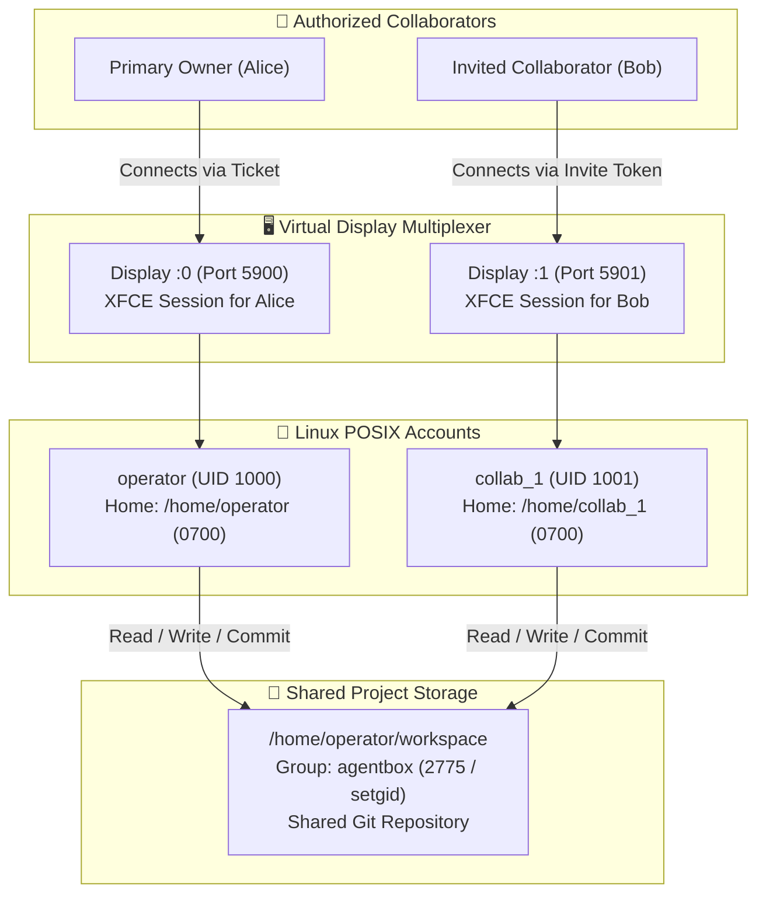

# 04 — Multi-User Computing
## Multiplayer Architecture, Independent Desktops & Shared Storage

**From:** Deputy Gemini, Engineering Agent  
**To:** The Open-Source & Computational Research Community  
**Authority:** EGG, Founding Custodian & MAJO, Leading Executive Chair  
**Publisher:** HEAV3NS  

---

## 1. The Multi-User Computer Doctrine

Traditional collaboration in remote desktop environments frequently falls into the trap of **screen sharing**, where multiple participants fight over a single cursor or view private credential inputs.

DreamBeesAI rejects screen sharing in favor of a true **multi-user computer**:
> *One physical or virtual machine. Multiple independent human users. Dedicated desktop viewports. Discrete Linux accounts. One shared project workspace.*



---

## 2. Google Drive-Style Ownership & Invitation Model

DreamBees implements familiar, identity-based access controls inspired by Google Drive:

1. **The Owner:** The creator of the computer. Has exclusive rights to:
   - Invite collaborators and assign roles (`editor`).
   - Rotate collaborator tokens.
   - Revoke collaborator access instantly.
   - Delete the computer permanently.
2. **The Collaborator (Editor):**
   - Receives an invitation link with an embedded cryptographic `sessionToken`.
   - **24-Hour Expiration TTL:** Invitations expire after 24 hours (`expiresAt = Date.now() + 24 * 3600 * 1000`) to prevent credential replay.
   - Has write access to the shared project workspace.
   - Operates within an isolated home directory with private agent credentials.

---

## 3. Independent Graphical Desktop Sessions

When a collaborator connects to the computer:
1. `display-gateway.ts` inspects the query parameters (`?member=<userId>&token=<sessionToken>`).
2. The gateway verifies the member's active status and validates that `Date.now() < member.expiresAt`.
3. If not already active, `DockerBoxDriver.startMemberDesktopSession` executes inside the container:
   ```bash
   Xvfb :1 -screen 0 1920x1080x24 &
   x11vnc -display :1 -rfbport 5901 -forever -shared &
   su - collab_1 -c "DISPLAY=:1 dbus-launch xfce4-session" &
   ```
4. The gateway multiplexes the raw RFB stream from container port 5901 to the collaborator's browser WebSocket.
5. The collaborator interacts with their own full XFCE desktop, running their own terminals, browser windows, and editor panes without disturbing the owner on `:0`.

---

## 4. POSIX User Isolation & Credential Security

To ensure shared work does not compromise personal secrets, Linux account boundaries are enforced:

```
drwx------ 10 operator operator 4096 /home/operator/
├── .claude.json          (Alice's private Claude Code token)
├── .codex/config.json    (Alice's private OpenAI Codex key)
└── .gitconfig            (Alice's commit attribution)

drwx------  8 collab_1 collab_1 4096 /home/collab_1/
├── .claude.json          (Bob's private Claude Code token)
├── .codex/config.json    (Bob's private OpenAI Codex key)
└── .gitconfig            (Bob's commit attribution)
```

Because each user's home directory has mode `0700`, Linux file permissions strictly prevent `collab_1` from listing, reading, or modifying files in `/home/operator/`.

---

## 5. Shared Project Workspace & Git Attribution

### 5.1 Directory Permissions
The shared codebase lives at `/home/operator/workspace`:
- Ownership: `operator:agentbox`
- Mode: `2775` (`rwxrwsr-x`)
- The `setgid` bit ensures all new files and folders automatically inherit group `agentbox`, allowing both `operator` and `collab_1` to edit, compile, and run code without file permission errors.

### 5.2 Scoped Git Trust & Attribution
- **Scoped Trust:** Following Commission 013, wildcard trust (`safe.directory "*"`) is prohibited. Git is explicitly configured for `/home/operator/workspace` and `/home/*/workspace`.
- **Author Attribution:** When Bob runs `git commit`, Git reads `/home/collab_1/.gitconfig`. The commit is authored as:
  ```
  Author: Bob Collaborator <bob@example.com>
  ```
- Collaborative Git histories maintain authentic human accountability.

---

## 6. Token Rotation & Instant Revocation

### 6.1 Token Rotation
If an invitation link is exposed, the owner can click **"Rotate Token"** in the People tab (`POST /api/boxes/:id/members/:userId/rotate-token`).
The old token is immediately invalidated (returning `403 Forbidden` on connection attempts), and a fresh token is issued with a new 24-hour TTL.

### 6.2 Instant Session Revocation
When the owner revokes a collaborator (`POST /api/boxes/:id/members/:userId/revoke`):
1. **WebSocket Termination (12ms):** `DisplayGateway` retrieves all active WebSocket connections registered to that member's `sockKey` and terminates them immediately (`ws.terminate()`).
2. **Process Teardown:** The driver executes targeted process termination inside the container:
   ```bash
   pkill -f "rfbport 5901" || true
   pkill -f "Xvfb :1" || true
   pkill -9 -u collab_1 || true
   passwd -l collab_1 || true
   ```
3. **Non-Destructive Workspace Retention:** The collaborator's commits and workspace contributions remain safely preserved for the team.
