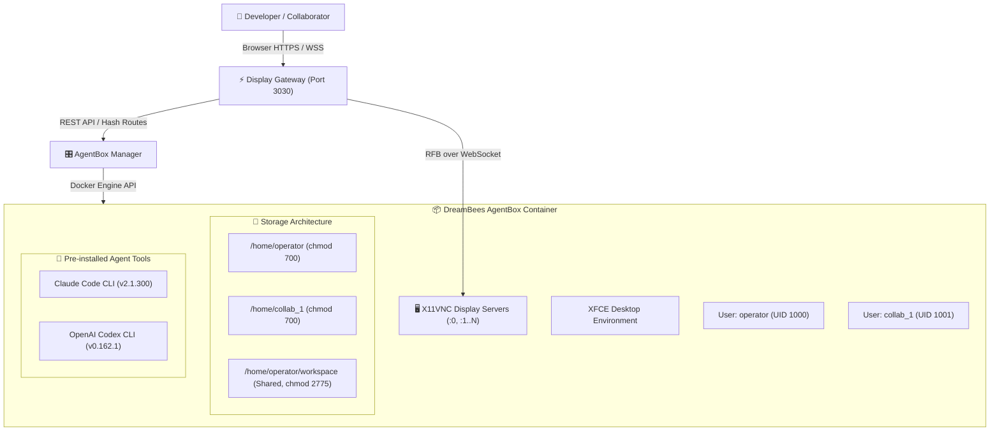

# DreamBeesAI · Technical Wiki & Architecture Archive
## Complete Reference Manual for the DreamBeesAI Computational Experiment

**Publisher:** HEAV3NS  
**Status:** ARCHIVED & FROZEN (Commission 014)  
**Repository:** `/Users/bozoegg/Desktop/dreambeesai`  
**Governing Doctrine:** *"Make the artifact understandable, reproducible, legally publishable, and useful to anyone who chooses to study or operate it independently."*

---

## Welcome to the Archive

DreamBeesAI is an open-source, self-hosted Linux workstation platform designed specifically for executing autonomous AI coding agents (such as Anthropic Claude Code and OpenAI Codex) in isolated, browser-accessible desktop environments.

This technical wiki provides an exhaustive, multi-dimensional account of the system: its genesis, architectural evolution, multi-user mechanics, agent integrations, security guarantees, performance baselines, and ultimate archival disposition.

---

## Wiki Table of Contents

| Chapter | Title | Summary |
| :--- | :--- | :--- |
| **[01 — Introduction](01-introduction.md)** | Overview & Project Scope | Motivation, core value proposition, what DreamBees is vs. what it is not, and freeze status. |
| **[02 — Historical Development](02-historical-development.md)** | Chronology of Commissions 008–013 | Evolution from raw containers to Unified AgentBoxes, independent multiplayer, Invisible Computer, and Boringly Excellent Computer. |
| **[03 — System Architecture](03-system-architecture.md)** | Core Architecture & Subsystems | Control plane, Docker runtime, desktop images, display bridge, session routing, persistent storage, and 10-state lifecycle engine. |
| **[04 — Multi-User Computing](04-multi-user-computing.md)** | Multiplayer Collaboration Engine | Google Drive ownership model, independent desktop sessions (:0, :1), POSIX UID separation, Git author attribution, and instant revocation. |
| **[05 — Agent Applications](05-agent-applications.md)** | AI Agent Ecosystem (BYOA) | Preinstalled Claude Code and OpenAI Codex, BYOK authentication mechanics, shared workspace execution, and tool launching. |
| **[06 — Installation & Operation](06-installation-and-operation.md)** | Operator's Runbook | Hardware requirements, local deployment, Docker image builds, environment configuration, daily operation, and backup/restore. |
| **[07 — Security](07-security.md)** | Threat Model & Trust Boundaries | Four-tier trust model, scoped `safe.directory`, symlink traversal defenses, credential isolation, and residual risks. |
| **[08 — Testing & Verification](08-testing-and-verification.md)** | Verification Ledger & Benchmarks | 16-suite test inventory, empirical latency benchmarks, verified vs. simulated vs. blocked classifications, and reproduction steps. |
| **[09 — Operational Economics](09-operational-economics.md)** | Compute Economics & Hosting | Transparent billing models, idle infrastructure costs, capacity scaling limits, and why commercial hosting was declined. |
| **[10 — Archival Record](10-archival-record.md)** | Institutional Provenance & Decisions | Architecture Decision Records (ADRs), superseded designs, unresolved questions, final freeze declaration, and institutional attribution. |

---

## Archival Provenance Summary
- **Current Version:** `1.0.0-archival` (Release Candidate 1)
- **Primary Authors:** EGG (Founding Custodian), MAJO (Leading Executive Chair), Deputy Gemini (Engineering Agent)
- **License:** Apache License 2.0 (Code) / All Rights Reserved for HEAV3NS Trademarks
- **Maintenance Status:** **FROZEN.** No new features or commercial hosting services will be introduced.
